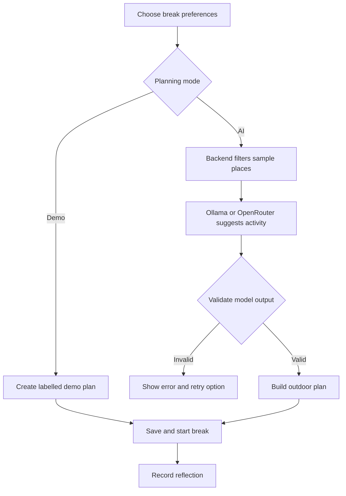

# 🌿 BreakTrail

### Less scrolling. More outside.

BreakTrail is an outdoor break planner that helps people turn a small gap in their day into time outside. Choose your mood, budget, starting area, and available time to get a short activity plan from a curated sample catalogue.

Built for the **Hacktoberfest Open-Source AI Challenge: Touch Grass**.

[Live App](https://breaktrail-nu.vercel.app/) · [Backend Health](https://breaktrail.onrender.com/api/health) · [Source Code](https://github.com/Anushkasharma101/breaktrail)

## Project status

The frontend and backend are deployed. The hosted AI integration is still being debugged: some model responses fail plan validation with `INVALID_AI_RESPONSE`. Demo mode is available for exploring the planning flow. A successful health or AI key check does not prove that end-to-end plan generation works.

The place catalogue contains illustrative Jaipur entries. BreakTrail does not currently offer live navigation, weather, crowd information, or verified opening hours. Check local access and conditions before heading out.

## Why BreakTrail?

A screen break often becomes another scrolling session. BreakTrail gives that break a purpose: choose a nearby outdoor moment, save the plan, put the screen away, and reflect afterward.

It is designed for developers, students, remote workers, and anyone who wants a short outdoor break during a busy day.

## Features

- **Personalized planning:** filter by mood, starting area, time, and budget.
- **AI activities:** suggest an activity and explanation from eligible catalogue places.
- **Explicit demo mode:** explore rule-based plans without presenting them as AI output.
- **Saved plans:** retain plans on your device and optionally sync to the backend.
- **Outdoor timer:** start, pause, and resume a break.
- **Reflections:** record how you felt and what you noticed.
- **Export and import:** transfer plans as JSON, export visual cards, and back up browser data.
- **Offline support:** access cached app screens, saved plans, and the timer after initial setup.
- **Visitor isolation:** public backend records are separated by private browser tokens.
- **Responsive interface:** a 24-screen React frontend for desktop and mobile.

## Live links

| Service | URL |
| --- | --- |
| Frontend | https://breaktrail-nu.vercel.app/ |
| Backend API | https://breaktrail.onrender.com/api |
| Health check | https://breaktrail.onrender.com/api/health |
| AI status | https://breaktrail.onrender.com/api/ollama/status |

The AI status path retains its original name for compatibility. When `AI_PROVIDER=openrouter`, it checks the OpenRouter key instead of an Ollama installation.

## Technology stack

| Layer | Technologies |
| --- | --- |
| Frontend | React 19, TypeScript, Vite |
| Styling | Tailwind CSS, Lucide icons |
| Offline interface | Vite PWA, service worker, browser storage |
| Backend | Node.js, Express 5 |
| Database | SQLite through `node:sqlite` |
| Validation | Zod |
| Local AI | Qwen3 through Ollama (`qwen3:0.6b`) |
| Hosted AI | OpenRouter free-model router |
| Tests | Vitest, Node test runner, Supertest |
| Hosting | Vercel frontend, Render backend |
| Optional server deployment | Docker Compose, Caddy, private Ollama |

## How planning works



The backend supplies eligible places to the model, checks the response shape and selected place ID, then builds the plan using catalogue data. Walking estimates are included in the time budget. These checks constrain the output but do not verify real-world travel times or access.

## AI options

### Local: Qwen3 with Ollama

Run Qwen locally using Ollama. Once dependencies and the model are downloaded, the local frontend/backend/model setup can operate without internet.

```dotenv
AI_PROVIDER=ollama
OLLAMA_BASE_URL=http://127.0.0.1:11434
OLLAMA_MODEL=qwen3:0.6b
```

### Hosted: OpenRouter

The hosted backend can use OpenRouter without requiring visitors to install a model.

```dotenv
AI_PROVIDER=openrouter
OPENROUTER_MODEL=openrouter/free
OPENROUTER_API_KEY=
```

Set the real key privately on the backend host. The free router may choose different available models and does **not** guarantee Qwen or a particular open-weight model. Free availability and quotas can change. The local Qwen/Ollama path is the project's explicit open-weight inference option.

Hosted prompts include the area, mood, budget, time, request text, and shortlist. Avoid entering sensitive information. The adapter excludes the user's name and device token from the model prompt.

## Run locally

### Requirements

- Node.js **22.13 or newer**.
- npm.
- Ollama and the Qwen model for local AI generation.

### 1. Clone the repository

```bash
git clone https://github.com/Anushkasharma101/breaktrail.git
cd breaktrail
```

### 2. Install dependencies

```bash
npm ci
npm --prefix backend ci
```

### 3. Configure environment files

Create a root `.env`:

```dotenv
VITE_API_BASE_URL=/api
```

Create `backend/.env`:

```dotenv
PUBLIC_MODE=false
HOST=127.0.0.1
PORT=3001
DATABASE_PATH=./data/breaktrail.sqlite
CLIENT_ORIGINS=http://localhost:5173,http://127.0.0.1:5173
AI_PROVIDER=ollama
OLLAMA_BASE_URL=http://127.0.0.1:11434
OLLAMA_MODEL=qwen3:0.6b
OLLAMA_TIMEOUT_MS=90000
ALLOW_RULE_FALLBACK=false
SERVE_FRONTEND=false
```

If `.env.example` files are present, copy them and adjust the values. Keep real `.env` files out of Git.

### 4. Prepare Ollama

Install and start Ollama, then download the model:

```bash
ollama pull qwen3:0.6b
```

### 5. Start the backend

```bash
npm run dev:api
```

### 6. Start the frontend in another terminal

```bash
npm run dev
```

Open http://localhost:5173. Vite forwards `/api` requests to the local backend. SQLite is created automatically with the sample place catalogue.

If the browser remembers an older API setting, open Settings, save `/api`, and test the connection.

## Free deployment configuration

### Render backend

| Setting | Value |
| --- | --- |
| Runtime | Node |
| Root directory | `backend` |
| Build command | `npm ci` |
| Start command | `npm start` |
| Health check | `/api/health` |

Configure the backend environment:

```dotenv
NODE_VERSION=22.16.0
PUBLIC_MODE=true
HOST=0.0.0.0
DATABASE_PATH=./data/breaktrail.sqlite
CLIENT_ORIGINS=https://breaktrail-nu.vercel.app
AI_PROVIDER=openrouter
OPENROUTER_MODEL=openrouter/free
OPENROUTER_API_KEY=
OLLAMA_TIMEOUT_MS=90000
ALLOW_RULE_FALLBACK=false
SERVE_FRONTEND=false
```

Enter the private API key in Render's environment settings and let Render supply `PORT`. Use the stable production frontend origin without a trailing slash.

### Vercel frontend

| Setting | Value |
| --- | --- |
| Framework | Vite |
| Root directory | Repository root |
| Build command | `npm run build` |
| Output directory | `dist` |

Set:

```dotenv
VITE_API_BASE_URL=https://breaktrail.onrender.com/api
```

Redeploy after changing this build-time variable. In the app's Settings, update any older saved API URL to the same value.

**Free hosting limitation:** Render Free's local SQLite data is temporary and can disappear after restarts, redeploys, or spin-down. Browser saved plans and reflections remain until browser storage is cleared. Export backups; do not rely on server-only records as your only copy. Persistent server storage requires a database migration or persistent hosting.

Render may need time to wake after inactivity. Open the health URL and retry the app connection after the service responds.

## Data and privacy

Public mode uses a random 256-bit browser bearer token. The backend hashes the token and scopes preferences, plans, history, snapshots, and deletion to that profile.

- Separate browsers have separate profiles.
- This is not an email/password account or cross-device login system.
- Keep device tokens private.
- Clearing browser storage loses access to that backend profile; export first.
- Export/import can transfer data between devices.
- Local mode retains a single local profile.

The OpenRouter key belongs only on the backend. Never place it in frontend code, `VITE_*` variables, screenshots, or `.env.example` files.

## API overview

All routes below are relative to `/api`. Private routes require `Authorization: Bearer <DEVICE_TOKEN>` in public mode; the frontend supplies it automatically.

| Method | Route | Purpose |
| --- | --- | --- |
| GET | `/health` | Backend health |
| GET | `/ollama/status` | Configured AI status |
| GET | `/places` | Filter sample places |
| GET | `/places/:id` | Sample place details |
| POST | `/plans` | Generate an AI plan |
| GET | `/plans/:id` | Retrieve a profile's plan |
| GET / PUT | `/preferences` | Read or update preferences |
| GET / POST | `/saved-plans` | Read or save plans |
| DELETE | `/saved-plans/:id` | Unsave a plan |
| GET / POST | `/history` | Read or add reflections |
| DELETE | `/history/:id` | Delete a history entry |
| GET / PUT | `/state` | Read or replace a profile snapshot |
| DELETE | `/data` | Clear a profile's backend data |

Health, AI status, and place GET routes are public. CORS restrictions alone are not authentication.

## Tests and build

```bash
npm test
npm run build
npm --prefix backend test
```

The prepared project passed **30 automated tests** and a production build during development. Tests cover frontend rendering, plan validation, AI error handling, SQLite persistence/rollback, legacy migration, and visitor isolation. AI provider tests use mocked responses; they do not verify real hosted inference. Run checks again after edits.

## Troubleshooting

| Error | Check |
| --- | --- |
| `Cannot POST /plans` | The API base URL must include `/api`. |
| `DEVICE_TOKEN_REQUIRED` | Deploy the frontend code that sends the browser token in the Authorization header. |
| CORS error | `CLIENT_ORIGINS` must match the exact frontend origin. Use the stable production domain. |
| `Missing script: start` | Render must use `backend/package.json`; confirm backend files are tracked as normal files, not a nested Git repository. |
| `INVALID_AI_RESPONSE` | The model output failed JSON/schema validation. Inspect safe diagnostic logs and improve provider/output handling. |
| `AI_RATE_LIMIT` | Retry later or use explicitly labelled demo mode. |
| Old frontend behavior | Apply the app update or test in a fresh incognito window to check for a stale PWA cache. |

## Contributing

Ideas for contributions include expanding the place catalogue, improving accessibility information, making structured AI output more reliable, adding durable hosted storage, and improving tests.

Fork the repository, create a branch, make your changes, run relevant checks, and open a pull request describing the behavior and validation. Avoid committing secrets or private database records.

## Author

**Anushka Sharma** — Full Stack Developer

[GitHub](https://github.com/Anushkasharma101)

## License

A project license has not been specified in this README. Check the repository for a `LICENSE` file before reusing or redistributing the code; public availability alone does not grant an open-source license.
